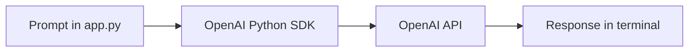

<div align="center">

# OpenAI API Lab

**A minimal Python example for sending a prompt to the OpenAI API and printing the response.**


</div>

## How it works



## Quick start

```bash
git clone https://github.com/Harshitsingh666/OPENAI-API-KEY.git
cd OPENAI-API-KEY
python -m venv .venv
```

Activate the environment and install the two packages used by the app:

```powershell
# Windows PowerShell
.\.venv\Scripts\Activate.ps1
python -m pip install openai python-dotenv
```

```bash
# macOS / Linux
source .venv/bin/activate
python -m pip install openai python-dotenv
```

## Configure and run

Create an API key from the [OpenAI dashboard](https://platform.openai.com/api-keys). Copy the safe template and add the key locally:

```powershell
Copy-Item .env.example .env
```

Edit `.env` so it contains:

```dotenv
OPENAI_API_KEY=your_api_key
```

Then run:

```bash
python app.py
```

## Project files

```text
.
├── app.py         # Sends a prompt and prints the model response
├── .env.example   # Safe environment-variable template
├── .gitignore     # Excludes local secrets and environments
└── README.md
```

## Security

Keep API keys out of source code, browser code, screenshots, and commits. If a key was committed previously, revoke it and create a replacement; deleting the latest copy does not erase Git history.

## License

No license file is currently listed. Add one before granting reuse permissions.
